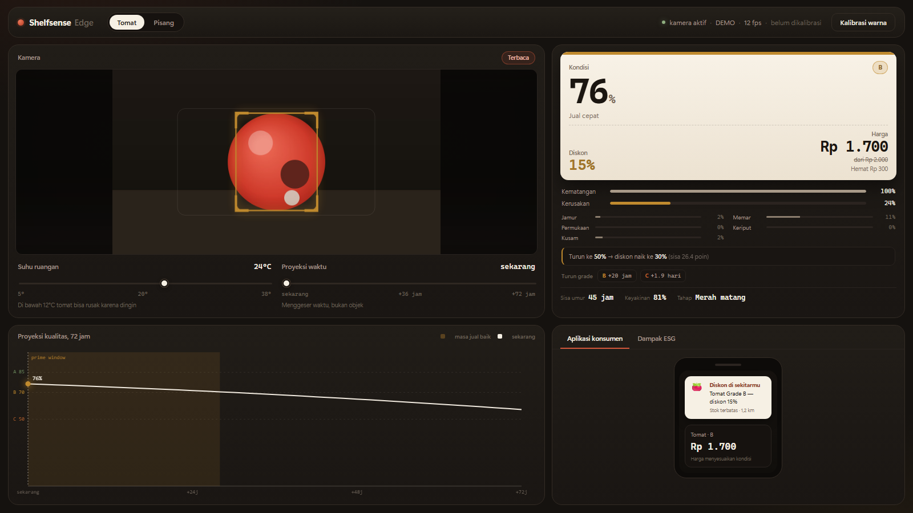

# ShelfSense Edge

Memindai satu tomat lewat kamera, menilai kondisinya, lalu menentukan diskon yang
masuk akal — real-time, langsung di perangkat.



```
kamera → deteksi tomat → kematangan × kerusakan → kondisi % → grade → diskon → harga
```

---

## Daftar isi

1. [Apa yang dilakukan sistem](#1-apa-yang-dilakukan-sistem)
2. [Cara kerjanya](#2-cara-kerjanya)
3. [Kebutuhan](#3-kebutuhan)
4. [Setup langkah demi langkah](#4-setup-langkah-demi-langkah)
5. [Menggunakan dashboard](#5-menggunakan-dashboard)
6. [Alur demo 5 babak](#6-alur-demo-5-babak)
7. [Konfigurasi](#7-konfigurasi)
8. [API](#8-api)
9. [Melatih ulang model](#9-melatih-ulang-model)
10. [Kalibrasi modul cacat](#10-kalibrasi-modul-cacat)
11. [Struktur proyek](#11-struktur-proyek)
12. [Troubleshooting](#12-troubleshooting)
13. [Batasan yang perlu diketahui](#13-batasan-yang-perlu-diketahui)
14. [Dataset dan lisensi](#14-dataset-dan-lisensi)

---

## 1. Apa yang dilakukan sistem

Satu tomat diletakkan di depan kamera. Dalam ±1 detik sistem menampilkan:

| Keluaran | Arti |
|---|---|
| **Kondisi %** | indeks kualitas visual = kematangan × (1 − kerusakan) |
| **Grade** | A / B / C / D, atau HOLD bila belum matang |
| **Diskon** | 0% / 15% / 30% / 50% |
| **Harga** | harga dasar dikurangi diskon, dibulatkan ke Rp 50 |
| **Sisa umur** | perkiraan jam sampai tidak layak jual |
| **Keyakinan** | seberapa yakin sistem pada pembacaan itu |

Yang **tidak** dilakukan sistem: mengukur rasa, kekerasan, atau kebusukan di dalam
buah. Lihat [batasan](#13-batasan-yang-perlu-diketahui).

---

## 2. Cara kerjanya

```
 webcam
   │
   ▼
 YOLOv8n ── deteksi tomat ──▶ crop
   │                            │
   │                            ▼
   │                    analisis HSV + Lab
   │                            │
   │              ┌─────────────┴─────────────┐
   │              ▼                           ▼
   │        kematangan (0–1)            kerusakan (0–1)
   │              │                           │
   │              └────────► kondisi = m × (1 − d)
   │                                          │
   │                     ┌────────────────────┴──────────────┐
   │                     ▼                                   ▼
   │              grade + diskon                   model umur simpan
   │                     │                        (Q10 + chilling injury)
   │                     └────────────► harga ◀──────────────┘
   ▼
 dashboard (WebSocket, ±12 fps)
```

**Empat sinyal kerusakan** (bobot di `backend/profiles/tomato.yaml`):

| Sinyal | Yang dicari | Bobot |
|---|---|---|
| Jamur | bercak pucat/putih terang di permukaan | 0,30 |
| Permukaan | porsi buah yang tidak lagi terlihat sehat | 0,30 |
| Memar | area jauh lebih gelap dari permukaan buah | 0,20 |
| Kusam | saturasi turun dibanding tahap kematangan | 0,10 |
| Keriput | tekstur frekuensi tinggi (Laplacian) | 0,05 |

**Aturan harga:**

| Grade | Kondisi | Diskon |
|---|---|---|
| A — Layak jual | ≥ 85% | 0% |
| B — Jual cepat | 70–84% | 15% |
| C — Potong harga | 50–69% | 30% |
| D — Sisa waktu kritis | < 50% | 50% |
| HOLD | belum matang | tidak didiskon |

Pengaman tambahan: diskon juga naik bila sisa umur menipis
(< 48 jam → minimal 15%, < 24 jam → 30%, < 10 jam → 50%).

---

## 3. Kebutuhan

| Komponen | Wajib? | Catatan |
|---|---|---|
| Python 3.10–3.12 | ✅ | diuji di 3.11.9 |
| Webcam | ⚠️ | sistem tetap jalan tanpa kamera lewat mode sintetis |
| GPU NVIDIA | tidak | hanya mempercepat training; inferensi CPU juga cukup |
| Koneksi internet | hanya saat setup | dashboard tidak memakai CDN |
| Disk kosong | ±8 GB | termasuk model, venv, dan dataset bila ingin training |

Dependensi utama: FastAPI, Uvicorn, OpenCV, PyTorch, Ultralytics, NumPy, PyYAML.

---

## 4. Setup langkah demi langkah

### 4.1 Clone repositori

```powershell
git clone https://github.com/bjbghjbv-cpu/Tomato.git
cd Tomato
```

### 4.2 Buat virtual environment

**Windows (PowerShell):**

```powershell
py -3.11 -m venv .venv
```

**macOS / Linux:**

```bash
python3.11 -m venv .venv
```

### 4.3 Pasang dependensi

**Windows:**

```powershell
.venv\Scripts\python -m pip install --upgrade pip
.venv\Scripts\python -m pip install -r requirements.txt
```

**macOS / Linux:**

```bash
.venv/bin/python -m pip install --upgrade pip
.venv/bin/python -m pip install -r requirements.txt
```

> **PyTorch wajib, versi CUDA tidak.**
> Ultralytics/YOLOv8 berjalan di atas PyTorch, jadi PyTorch harus ada. Tapi
> wheel CUDA (2,5 GB) hanya diperlukan untuk **training cepat**.
>
> | | CPU | CUDA (cu124) |
> |---|---|---|
> | Unduhan | ±200 MB | ±2,5 GB |
> | Terpakai di disk | ±1 GB | ±5 GB |
> | Menjalankan dashboard | ✅ | ✅ |
> | Inferensi YOLO | 30–80 ms/frame | 5–10 ms/frame |
> | Training | bisa, tapi lambat | 80 epoch ≈ 17 menit (RTX 3060) |
>
> **Hanya untuk menjalankan dashboard — pasang versi CPU lebih dulu:**
>
> ```powershell
> .venv\Scripts\python -m pip install torch torchvision --index-url https://download.pytorch.org/whl/cpu
> .venv\Scripts\python -m pip install -r requirements.txt
> ```
>
> **Kalau ingin training di GPU**, pasang wheel CUDA sebelum `requirements.txt`:
>
> ```powershell
> .venv\Scripts\python -m pip install torch torchvision --index-url https://download.pytorch.org/whl/cu124
> ```
>
> Urutannya penting: PyTorch dulu, baru `requirements.txt`. Kalau dibalik, pip
> memasang wheel default yang lebih besar. Berpindah dari CPU ke CUDA nanti:
>
> ```powershell
> .venv\Scripts\python -m pip install torch torchvision --index-url https://download.pytorch.org/whl/cu124 --force-reinstall
> ```

### 4.4 Model

Model sudah disertakan di repositori:

```
models/
├── best.pt        (6 MB, YOLOv8n 1 kelas: tomato)
└── classes.json   (kelas yang benar-benar dilatih)
```

Tidak ada unduhan tambahan. Kalau ingin melatih sendiri, lihat [bagian 9](#9-melatih-ulang-model).

### 4.5 Cek kamera

```powershell
.venv\Scripts\python tools\find_camera.py
```

Script memindai indeks 0–5, menampilkan resolusi dan tingkat kecerahan, lalu
menyarankan indeks yang benar. Contoh keluaran:

```
  0: 640x480  brightness=  0.7  gelap
  1: 1280x720 brightness= 96.4  ada gambar
kamera yang tampak aktif: [1]
```

Kalau tidak ada kamera yang terang, lanjut ke langkah 4.6 dengan mode sintetis.

### 4.6 Jalankan

**Windows:**

```powershell
.\run.ps1                  # kamera asli
.\run.ps1 -Synthetic       # tanpa kamera
.\run.ps1 -Camera 1        # pilih indeks kamera
.\run.ps1 -Port 8080       # ganti port
```

**macOS / Linux:**

```bash
.venv/bin/python -m uvicorn backend.main:app --host 127.0.0.1 --port 8000
```

Buka <http://127.0.0.1:8000>.

| URL | Fungsi |
|---|---|
| `/` | dashboard dengan kamera |
| `/?demo=1` | pratinjau UI tanpa kamera (berguna saat latihan presentasi) |

**Mematikan server:** `Ctrl + C` di terminal, atau `.\stop.ps1` bila jendelanya
sudah hilang.

---

## 5. Menggunakan dashboard

### Tata letak

```
┌──────────────────────────────────────────────┬────────────────────────┐
│ Kamera + kotak deteksi                       │  Label harga (kertas)  │
│                                              │  kondisi % · grade     │
│                                              │  diskon · harga        │
│  ────────────────────────────────────────    │                        │
│  Suhu ruangan        Proyeksi waktu          │  Rincian kerusakan     │
├──────────────────────────────────────────────┼────────────────────────┤
│ Proyeksi kualitas 72 jam                     │  Aplikasi konsumen/ESG │
└──────────────────────────────────────────────┴────────────────────────┘
```

### Scan lalu kunci

| Keadaan | Tanda di layar |
|---|---|
| Tomat masuk bingkai | badge **Memindai…** |
| Diam ±1,5 detik | badge **Terbaca** — angka final |
| Hasil meragukan | badge **Perlu dicek** |
| Tidak ada objek | **Letakkan tomat di tengah bingkai** |

Angka sengaja diratakan (EMA + hysteresis) supaya harga tidak berkedip saat
tangan sedikit bergerak.

### Slider

- **Suhu ruangan (5–38°C)** — mengubah proyeksi umur simpan. Responsnya berbentuk
  U: terlalu dingin juga merusak (chilling injury), optimum sekitar 12°C.
- **Proyeksi waktu (0–72 jam)** — menggeser objek yang sama ke masa depan,
  menunjukkan kapan grade dan harganya akan turun.

### Kalibrasi warna

1. Letakkan kertas putih atau kartu abu-abu di tengah layar.
2. Tekan **Kalibrasi warna**.
3. Sistem menunggu 2,5 detik, lalu mengunci white balance.

Lakukan ini setiap kali tempat atau lampu berubah. Status di header berubah
menjadi **✓ terkalibrasi**.

### Ganti profil komoditas

Tombol **Tomat / Pisang** di header mengganti seluruh parameter — ambang warna,
harga dasar, kurva umur simpan — tanpa melatih ulang. Ini bukti bahwa menambah
komoditas cukup menambah file YAML.

---

## 6. Alur demo 5 babak

| # | Aksi | Yang terbukti |
|---|---|---|
| 1 | Letakkan tomat | deteksi + kondisi + diskon muncul ±1 detik |
| 2 | Diamkan | badge **Terbaca** — hasil stabil, tidak berkedip |
| 3 | Suhu 20 → 35°C | sisa umur turun, diskon bisa naik sendiri |
| 4 | Suhu 20 → 5°C | dingin **tidak** memperpanjang umur (chilling injury) |
| 5 | Geser waktu 0 → 72 jam | kurva bergerak, harga jatuh melewati grade |

Cadangan bila kamera bermasalah: buka `/?demo=1` — seluruh UI tetap bekerja.

---

## 7. Konfigurasi

### Variabel lingkungan

| Variabel | Default | Fungsi |
|---|---|---|
| `SSE_CAMERA` | `0` | indeks kamera |
| `SSE_MODEL` | `models/best.pt` | path bobot YOLO |
| `SSE_PROFILE` | `tomato` | profil awal |
| `SSE_SYNTHETIC` | `0` | `1` = kamera palsu |

Contoh:

```powershell
$env:SSE_CAMERA="1"; $env:SSE_SYNTHETIC="0"
.\run.ps1
```

### Profil komoditas

Semua ambang biologis dan aturan bisnis ada di
`backend/profiles/tomato.yaml` — bukan di kode. Potongan pentingnya:

```yaml
stages:                       # tahap kematangan, hue OpenCV 0-179
  - { name: red_ripe, hue: [[0,5],[173,179]], quality: 1.00 }

defect:
  weights: { mold: 0.30, anomaly: 0.30, bruise: 0.20, dullness: 0.10, wrinkle: 0.05 }
  mold:    { s_max: 60, v_min: 120, v_max: 250, full_scale: 0.05 }
  anomaly: { lo: 0.12, hi: 0.75 }

shelf_life:
  q10: 2.2
  chilling_threshold_c: 12
  chilling_severity: 3.5

grades:
  - { grade: A, min_condition: 85, discount: 0,  label: "Layak jual" }
  - { grade: B, min_condition: 70, discount: 15, label: "Jual cepat" }
  - { grade: C, min_condition: 50, discount: 30, label: "Potong harga" }
  - { grade: D, min_condition: 0,  discount: 50, label: "Sisa waktu kritis" }

hours_rules:                  # pengaman berdasarkan sisa umur
  - { max_hours: 10, discount: 50 }
  - { max_hours: 24, discount: 30 }
  - { max_hours: 48, discount: 15 }
```

Restart server setelah mengubah YAML.

---

## 8. API

| Metode | Endpoint | Fungsi |
|---|---|---|
| `GET` | `/` | dashboard |
| `GET` | `/health` | health check |
| `GET` | `/api/status` | status kamera, model, profil |
| `GET` | `/api/profiles` | daftar profil beserta aturan harga |
| `POST` | `/api/env` | `{ "temp_c": 30, "rh": 88, "time_offset_h": 12 }` |
| `POST` | `/api/profile` | `{ "id": "banana" }` |
| `POST` | `/api/calibrate` | kalibrasi white balance dari frame saat ini |
| `POST` | `/api/scan` | mode foto: `{ "image": "data:image/jpeg;base64,…", "source": "auto" }` |
| `WS` | `/ws` | stream frame (JPEG base64) + telemetri JSON |

Contoh mode foto:

```powershell
curl.exe -X POST http://127.0.0.1:8000/api/scan `
  -H "Content-Type: application/json" `
  -d "{\"image\":\"$(Get-Content foto.b64 -Raw)\",\"source\":\"auto\"}"
```

`source` bisa `auto` (YOLO → warna → zona tengah), `color`, atau `roi`.

---

## 9. Melatih ulang model

Butuh ±4 GB unduhan dan waktu training ±20 menit di RTX 3060.

### 9.1 Siapkan dataset

```powershell
# lihat isi dataset mentah (opsional, memicu unduhan)
.venv\Scripts\python tools\prepare_dataset.py --inspect

# unduh + konversi ke format YOLO
.venv\Scripts\python tools\prepare_dataset.py --out data --no-banana
```

Sumber:

| Kelas | Dataset | Isi |
|---|---|---|
| tomato | `Project-AgML/tomato_ripeness_detection` | 804 gambar, 9.777 bbox |
| tomato | `Project-AgML/tomato_adaptive_yolov8_detection` | 604 gambar, 2.802 bbox |
| banana | COCO 2017 (opsional, `--no-banana` untuk melewati) | — |

Hasil: 1.395 gambar / 12.035 bbox, split 1.126 train · 123 val · 146 test,
`data/data.yaml`, dan `data/manifest.csv`.

### 9.2 Latih

```powershell
.venv\Scripts\python tools\train.py                 # 100 epoch
.venv\Scripts\python tools\train.py --quick         # 5 epoch, uji cepat
.venv\Scripts\python tools\train.py --epochs 150 --batch 8
```

Bobot terbaik otomatis disalin ke `models/best.pt`, log dan grafik di
`runs/tomato_banana/`.

### 9.3 Evaluasi

```powershell
.venv\Scripts\python tools\inspect_image.py foto_tomat\  # per gambar
.venv\Scripts\python tools\verify_labels.py --data data --n 8
```

Performa model yang disertakan:

| Metrik | Validation | Test (held-out) |
|---|---|---|
| mAP50 | 0,754 | 0,744 |
| mAP50-95 | 0,628 | 0,603 |
| Precision | 0,891 | 0,899 |
| Recall | 0,694 | 0,670 |

---

## 10. Kalibrasi modul cacat

Penilaian kebusukan **bukan model** — ia aturan terukur. Untuk menguji pada foto asli,
siapkan dua folder:

```
tomatsegar/      foto tomat sehat
gambartomatbusuk/ foto tomat busuk
```

Lalu:

```powershell
.venv\Scripts\python tools\defect_bench.py
.venv\Scripts\python tools\defect_bench.py --sweep     # cari ambang terbaik
```

Contoh keluaran:

```
kelas   foto                    kondisi  grade  diskon   sinyal
BUSUK   images (5).jpg           45.5%      D     50%   mold=0.61 bruise=0.66 dullness=0.62
SEGAR   images (10).jpg          97.0%      A      0%   bruise=0.06

SEKARANG: segar lulus 3/3, busuk lulus 5/10
```

Gunakan `--sweep` untuk mencari kombinasi ambang, lalu salin angkanya ke
`backend/profiles/tomato.yaml`.

---

## 11. Struktur proyek

```
backend/
  main.py                 FastAPI + WebSocket
  profiles/
    tomato.yaml           semua ambang & aturan bisnis
    banana.yaml           bukti: tambah komoditas = tambah file
  core/
    grader.py             HSV/Lab, kematangan, 5 sinyal kerusakan
    shelf_life.py         dua proses (pematangan vs pembusukan) + chilling
    pricing.py            kondisi → grade → diskon → harga
    vision.py             kamera, deteksi, smoothing, scan & lock
web/
  index.html              dashboard
  style.css               tema "label rak": kertas, tinta, aksen tomat
  app.js                  WebSocket, chart, interaksi
tools/
  prepare_dataset.py      parquet AgML → YOLO (dedup, resize, split)
  train.py                training + salin best.pt
  inspect_image.py        cek satu foto lewat pipeline yang sama
  defect_bench.py         uji & setel ambang cacat
  verify_labels.py        lembar pratinjau bbox
  check_numbers.py        tabel sisa umur & harga
  smoke_test.py           uji end-to-end server
  ws_probe.py             intip satu pesan WebSocket
  find_camera.py          cari indeks kamera yang aktif
tests/
  test_core.py            18 unit test
models/
  best.pt                 bobot YOLOv8n (6 MB)
  classes.json            kelas yang benar-benar dilatih
run.ps1 / stop.ps1        jalankan / hentikan server (Windows)
```

---

## 12. Troubleshooting

| Gejala | Penyebab | Solusi |
|---|---|---|
| **"warna buah tidak dikenali"** | kamera gelap, tertutup, atau salah perangkat | jalankan `tools\find_camera.py`, cek privacy shutter, izin kamera Windows |
| **Kamera 0 menampilkan "Please start Iriun"** | kamera virtual Iriun belum aktif | pakai indeks lain: `.\run.ps1 -Camera 1` |
| **"kelas 'tomato' belum dilatih"** | `models/classes.json` tidak ada / kosong | pastikan file berisi `{"classes": ["tomato"]}` |
| **Model tidak dipakai (detector = color)** | `models/best.pt` hilang | latih ulang (§9) atau biarkan fallback warna bekerja |
| **Harga berkedip-kedip** | objek bergerak cepat / cahaya tidak stabil | diamkan 1,5 detik, tekan Kalibrasi warna |
| **Tomat busuk tetap dapat Grade A** | kerusakan hanya tekstur (keriput halus) | lihat §13, atau setel ambang di `tomato.yaml` |
| **`Address already in use`** | server lain di port 8000 | `.\stop.ps1` atau `.\run.ps1 -Port 8080` |
| **Dashboard kosong / tidak ada frame** | WebSocket gagal | pastikan server hidup, buka `http://127.0.0.1:8000` (bukan `file://`) |
| **Training sangat lambat** | PyTorch versi CPU | pasang wheel CUDA (§4.3) |
| **`cv2` tidak ditemukan** | venv belum aktif | pakai `.venv\Scripts\python`, bukan `python` global |

---

## 13. Batasan yang perlu diketahui

Sistem ini adalah **indeks kualitas visual**, bukan pengukuran laboratorium.

Kamera tidak bisa melihat:

- busuk di dalam buah, kekerasan daging, rasa, kadar gula
- cacat di sisi yang tidak menghadap kamera
- residu pestisida atau kandungan kimia

Keterbatasan teknis yang sudah terukur:

- **Kerusakan tekstur** (keriput halus, retak) hampir tidak mengubah warna,
  sehingga sering masih terbaca Grade A. Dari 10 foto busuk uji, 5 turun ke C/D
  dan 7 minimal B; sisanya lolos karena kerusakannya hanya tekstur.
- **Recall model 0,67** pada data uji publik — sebagian tomat kecil di foto kebun
  terlewat. Untuk satu tomat besar di tengah bingkai hasilnya jauh lebih baik, dan
  fallback warna menjaga layar tidak pernah kosong.
- **Akurasi diukur pada data publik**, bukan pada panggung demo. Validasi di venue
  bersifat manual lewat checklist rehearsal.

Karena itu tersedia indikator **keyakinan** dan status **Perlu dicek**. Manusia
tetap pemutus akhir.

### Checklist rehearsal (±10 menit)

1. Jalankan server, letakkan tomat.
2. Kalibrasi dengan kertas putih.
3. Cek grade masuk akal: segar → A/B, memar/berjamur → C/D.
4. Jika tomat jelas rusak masih terbaca A, naikkan keparahan fisik atau setel
   ambang di `tomato.yaml`.
5. Uji slider suhu 35°C dan 5°C.
6. Hindari lampu yang menyorot langsung ke permukaan buah (glare bisa terbaca
   sebagai jamur).

---

## 14. Dataset dan lisensi

| Sumber | Isi | Lisensi |
|---|---|---|
| [Project-AgML/tomato_ripeness_detection](https://huggingface.co/datasets/Project-AgML/tomato_ripeness_detection) | 804 gambar, 9.777 bbox (asal Laboro Tomato) | lihat sumber asal |
| [Project-AgML/tomato_adaptive_yolov8_detection](https://huggingface.co/datasets/Project-AgML/tomato_adaptive_yolov8_detection) | 604 gambar, 2.802 bbox | CC BY 4.0 |
| COCO 2017 (opsional) | kelas banana | CC BY 4.0 (anotasi) |

Kode proyek ini dilisensikan MIT. Foto contoh di `tomatsegar/` dan
`gambartomatbusuk/` **tidak disertakan** di repositori karena sebagian berasal
dari stok foto ber-watermark dan hanya dipakai untuk kalibrasi lokal.

Dibangun dengan [Ultralytics YOLOv8](https://github.com/ultralytics/ultralytics),
[FastAPI](https://fastapi.tiangolo.com/), dan [OpenCV](https://opencv.org/).
